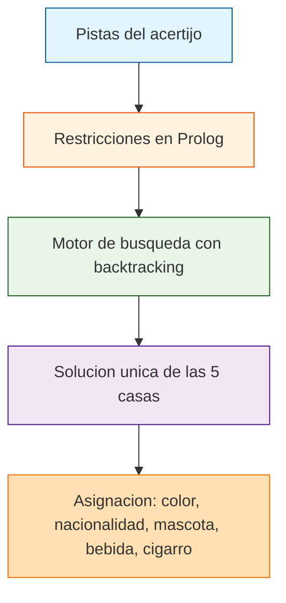

# Problema de las Casas (Acertijo de Einstein)

<p align="center">
  <a href="https://github.com/Matthew-Garay/Problema-de-las-casas/actions/workflows/ci.yml"></a>
  <a href="https://github.com/Matthew-Garay/Problema-de-las-casas/security/dependabot"></a>
</p>

Resolucion del acertijo de las cinco casas (tambien conocido como el Acertijo de Einstein o Zebra Puzzle) en Prolog. Cinco vecinos, cinco colores, cinco nacionalidades, cinco mascotas, cinco bebidas y cinco cigarros, con 14 pistas que dejan una unica solucion.

Cada pista se traduce a una restriccion sobre la lista `Casitas`; el motor de busqueda de Prolog encuentra la unica asignacion que satisface todas las restricciones.

## Stack tecnologico

- **Lenguaje:** SWI-Prolog
- **Paradigma:** Programacion logica, resolucion por restricciones
- **Entorno:** SWI-Prolog 8.x

## Arquitectura



## Caracteristicas

- Resolucion del acertijo de las cinco casas con 14 pistas logicas
- Uso de predicados de Prolog para modelar restricciones
- Busqueda con backtracking para encontrar la solucion unica
- Codigo modular y documentado

## Como ejecutar

### Requisitos previos

- SWI-Prolog 8.x instalado

### Ejecucion

1. Clona el repositorio:
   ```bash
   git clone https://github.com/Matthew-Garay/Problema-de-las-casas.git
   cd Problema-de-las-casas
   ```
2. Ejecuta el archivo principal con SWI-Prolog:
   ```bash
   swipl -s problemascasas3.pl -g "main" -t "halt"
   ```
3. El programa muestra la solucion completa del acertijo en consola.

## Estructura del proyecto

```
Problema-de-las-casas/
├── problemascasas3.pl       # Codigo fuente en Prolog
├── Casas.xlsx               # Datos de referencia del acertijo
├── .gitignore               # Archivos excluidos del control de versiones
├── LICENSE                  # Licencia MIT
├── README.md                # Este archivo
└── docs/                    # Documentacion extendida
    ├── setup-guide.md       # Guia de instalacion
    └── architecture.md      # Diagrama de arquitectura
```

## Contacto

<p align="center">
  <a href="mailto:1911.garay.perez@gmail.com"></a>
  <a href="https://www.linkedin.com/in/matthewgarayperez/"></a>
</p>
